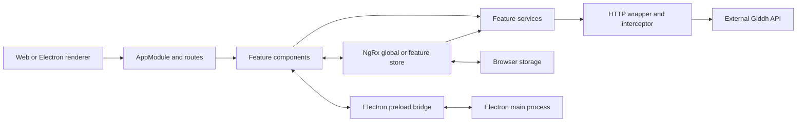

# Architecture

**Observed:** source on `giddh-2.0` at `970543b`, reviewed 2026-10-23. This repository contains an Angular accounting client and its Electron shell; the accounting backend lives outside this checkout. These are code ownership boundaries, not team assignments. Approved product direction belongs in [VISION](VISION.md).

## Where a change belongs

| Area | Owner and entry point |
| --- | --- |
| Web startup and configuration | [main.ts](../apps/web-giddh/src/main.ts) bootstraps `AppModule`; [app.module.ts](../apps/web-giddh/src/app/app.module.ts) registers routing, global state, HTTP and white-label initialization. |
| Navigation and signed-in shell | [app.routes.ts](../apps/web-giddh/src/app/app.routes.ts) mounts `PageComponent` at `/pages` and loads feature routes. [CompanyBranchComponent](../apps/web-giddh/src/app/shared/primary-sidebar/company-branch/company-branch.component.ts) switches company/branch context. |
| Accounting features | [vouchers](../apps/web-giddh/src/app/vouchers/vouchers.routing.module.ts) owns current voucher create/list/preview journeys; [ledger](../apps/web-giddh/src/app/ledger/ledger.module.ts), [financial reports](../apps/web-giddh/src/app/financial-reports/financial-reports.module.ts) and [inventory](../apps/web-giddh/src/app/new-inventory/new-inventory.module.ts) are separate feature areas. Older `invoice`, `voucher` and `inventory` routes coexist: trace the actual URL before editing. |
| Shared UI and appearance | `shared/`, `theme/` and [CSS utilities](../apps/web-giddh/src/assets/styles/CSS_UTILITIES.md); see [DESIGN](DESIGN.md) before creating a component or style. |
| Global state and effects | [AppState/reducers](../apps/web-giddh/src/app/store/roots.ts) defines slices; [ActionModule](../apps/web-giddh/src/app/actions/action.module.ts) registers effects. Classes such as `LoginActions` contain both action factories and effects. |
| Feature state and API access | Feature stores such as [VoucherComponentStore](../apps/web-giddh/src/app/vouchers/utility/vouchers.store.ts) manage screen data/loading; [VoucherService](../apps/web-giddh/src/app/services/voucher.service.ts) owns endpoint calls. Some components call services directly. |
| Desktop shell | [index.ts](../apps/electron-giddh/src/index.ts) owns lifecycle, tray and OAuth; [WindowManager](../apps/electron-giddh/src/WindowManager.ts) owns windows; [AppUpdater](../apps/electron-giddh/src/AppUpdater.ts) owns updates. [main.electron.ts](../apps/web-giddh/src/main.electron.ts) bootstraps the shared Angular UI with hash routing. |

The diagram's concrete boundaries are [routing](../apps/web-giddh/src/app/app.routes.ts), [state](../apps/web-giddh/src/app/store/roots.ts), [HTTP](../apps/web-giddh/src/app/services/http-wrapper.service.ts), [storage adapter](../apps/web-giddh/src/app/app.module.ts) and [preload bridge](../apps/electron-giddh/src/preload.js).

## Data and state ownership

A typical global flow is component → action → effect → service → response action → reducer → subscribed view. Feature `ComponentStore` effects offer a second path; voucher creation also calls `VoucherService` directly. Follow the existing owner for the affected journey instead of introducing another store.

`session` holds identity, active company/branch, locale and theme; feature slices hold accounting data. [GeneralService](../apps/web-giddh/src/app/services/general.service.ts) also exposes mutable company/session context used by API services. A company switch therefore affects more than the header: endpoint paths, permissions, invoice settings, warehouses and subsequent requests depend on it. [FLOWS](FLOWS.md) traces this change.

`createHybridStorage` in `AppModule` separates tab-specific company/branch state from persistent identity/preferences. The interceptor has a separate session restoration implementation. IndexedDB stores navigation data through [DbService](../apps/web-giddh/src/app/services/db.service.ts). Exact persistence boundaries belong in [CONTRACTS](CONTRACTS.md).

[WhiteLabelService](../apps/web-giddh/src/app/services/white-label.service.ts) combines white-label configuration with environment defaults; `ServiceConfig` supplies resolved values to consumers. Reuse [white-label.md](white-label.md) for fields and getters. The actual startup sequence is `fetchWhiteLabel` / `getServiceConfig` in `AppModule`.

Electron reuses the web feature code. Renderer access goes through [ElectronService](../apps/web-giddh/src/app/services/electron.service.ts) and channel allowlists in `preload.js`; operating-system work belongs in the main process. The existing [Electron environment guide](README-ELECTRON-BRANCH-ENV.md) provides background, but its advertised npm aliases do not all exist in current [package.json](../package.json). Use [DEVELOPMENT](DEVELOPMENT.md) for verified commands.

## Boundaries to preserve

The [current Angular rules](../.cursor/rules/angular-giddh-coding-rules.mdc) guide changed code. Existing NgModules, NgRx, mutable state and compatibility patches are observed implementation, not approval for a wholesale migration. `AppModule` currently disables NgRx state/action immutability checks.

Permission checks, session headers, API versions, storage keys and Electron channels cross feature boundaries; consult [CONTRACTS](CONTRACTS.md) before changing them. Backend authorization and transaction guarantees cannot be established from this client. See [OPEN_QUESTIONS](OPEN_QUESTIONS.md) for decisions needing outside evidence.
