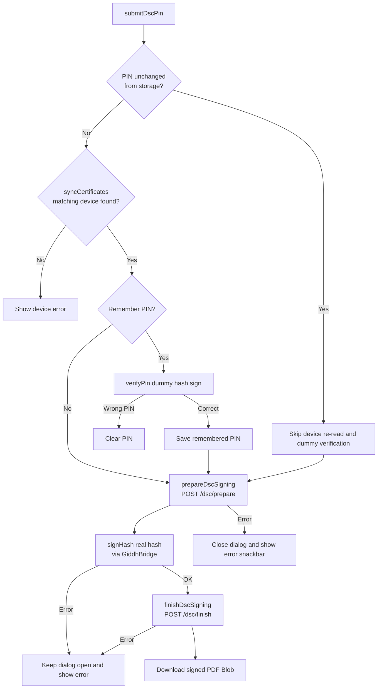

# DSC Signed Invoice Download Flow

## Overview

This document explains the end-to-end flow for downloading a **digitally signed invoice PDF** using a USB DSC (Digital Signature Certificate) token in Giddh.

The flow is used from voucher list, create, preview and attachment views. It is built around a reusable Angular Material dialog that communicates with a browser extension/native host (`GiddhBridge`) to read certificates from a token and sign a PDF hash. The behavior below follows [DscSignDialogService](../apps/web-giddh/src/app/services/dsc-sign-dialog.service.ts), [DscPinDialogComponent](../apps/web-giddh/src/app/vouchers/dsc-pin-dialog/dsc-pin-dialog.component.ts) and [DscPinStorageService](../apps/web-giddh/src/app/services/dsc-pin-storage.service.ts), reviewed 2026-10-23.

---

## High-level Architecture

```text
┌─────────────────────┐     ┌──────────────────────────┐     ┌─────────────────────┐
│  Voucher List Page  │     │   DscSignDialogService   │     │  DscPinDialogComponent│
│  (list.component.ts)│────▶│  (opens immediately)     │────▶│ (UI + bridge check)   │
└─────────────────────┘     └──────────────────────────┘     └──────────┬──────────┘
                                                                         │
                              ┌──────────────────────┐                   │
                              │  Voucher Create Page │                   │
                              │ (create.component.ts)│───────────────────┘
                              └──────────────────────┘

                                                                         │
                                                                         ▼
                              ┌─────────────────────────────────────────────────────┐
                              │              DscService (core engine)               │
                              │  • Bridge detection                                 │
                              │  • Certificate read/sync/cache                      │
                              │  • PIN verification                                 │
                              │  • prepareDscSigning → signHash → finishDscSigning  │
                              └──────────────────────┬──────────────────────────────┘
                                                     │
           ┌─────────────────────────────────────────┼──────────────────────────────────────────┐
           │                                         │                                          │
           ▼                                         ▼                                          ▼
  ┌──────────────────┐                    ┌──────────────────┐                       ┌──────────────────┐
  │  window.GiddhBridge│                   │  Giddh Backend   │                       │ DscPinStorageService│
  │ (browser extension │                   │  /dsc/prepare    │                       │ (encrypted PIN     │
  │  / native host)    │                   │  /dsc/finish     │                       │  cache in          │
  └──────────────────┘                    └──────────────────┘                       │  localStorage)     │
                                                                                      └──────────────────┘
```

---

## Sequence Diagram

```mermaid
sequenceDiagram
    actor User
    participant List as VoucherListComponent
    participant Create as VoucherCreateComponent
    participant Service as DscSignDialogService
    participant Dialog as DscPinDialogComponent
    participant Dsc as DscService
    participant Bridge as window.GiddhBridge
    participant API as Backend /dsc/*
    participant PinStore as DscPinStorageService

    Note over List, Create: Parent page ngOnInit
    List->>Dsc: preloadCertificates()
    Create->>Dsc: preloadCertificates()
    Dsc->>Bridge: getCertificate()
    Bridge-->>Dsc: certificates[]
    Dsc->>Dsc: cache + localStorage
    Dsc-->>List: certificates / complete
    Dsc-->>Create: certificates / complete

    User->>List: Clicks "Download Signed PDF"
    List->>Service: openDownloadSignedInvoiceDialog({ voucher, voucherType })
    Service->>Dialog: open immediately (disableClose: true)
    Dialog->>Dsc: isBridgeAvailable()

    alt Bridge not available
        Dialog->>Dialog: show bridge_not_found and download action
    else Bridge available
        Dialog->>Dsc: getCachedCertificatesSnapshot()
        Dsc-->>Dialog: cached certificate list (immediate)
        alt no completed certificate read yet
            Dialog->>Dsc: syncCertificates() (joins an in-flight read)
            Dsc-->>Dialog: certificates or setup error
        end
        Dialog->>PinStore: getPin(selectedCertificate)
        PinStore-->>Dialog: remembered PIN (if any)

        User->>Dialog: Enters/selects PIN and clicks Confirm
        opt rememberPin unchecked
            Dialog->>PinStore: forgetPin(certificate)
        end
        alt PIN is unchanged remembered PIN
            Note over Dialog: skip device re-read and dummy verification
        else PIN is new or edited
            Dialog->>Dsc: syncCertificates()
            Dsc->>Bridge: getCertificate()
            Bridge-->>Dsc: certificates[]
            Dsc-->>Dialog: fresh matching certificate or error
            opt rememberPin checked and device found
                Dialog->>Dsc: verifyPin(certificate, pin)
                Dsc->>Bridge: signHash(dummyHash, SHA256, certId, pin)
                Bridge-->>Dsc: success / error
                alt PIN correct
                    Dialog->>PinStore: savePin(certificate, pin, duration)
                else
                    Dialog->>Dialog: clear PIN and show error
                end
            end
        end

        opt setup succeeded
            Dialog->>Dsc: prepareDscSigning(voucherDetails, certificate)
            Dsc->>API: POST /dsc/prepare
            API-->>Dsc: { hash, nonce } or error
            alt prepare failed
                Dialog->>Dialog: close and show error snackbar
            else prepared
                Dialog->>Dsc: signHash(hash, certificate, pin)
                Dsc->>Bridge: signHash(...)
                Bridge-->>Dsc: signature or error
                opt signature available
                    Dialog->>Dsc: finishDscSigning(nonce, signature)
                    Dsc->>API: POST /dsc/finish
                    API-->>Dsc: signed PDF Blob or error
                end
                alt sign or finish failed
                    Dialog->>Dialog: keep open and show error
                else PDF returned
                    Dialog->>Dialog: close, downloadBlob and success snackbar
                end
            end
        end
    end

    User->>Create: Saves voucher with "Save & Download Signed PDF"
    Create->>Create: saveVoucher(callback)
    Create->>Service: openDownloadSignedInvoiceDialog({ voucher: response.body, voucherType })
    Service->>Dialog: same flow as above
```

---

## File Reference

| File | Purpose |
|------|---------|
| `apps/web-giddh/src/app/services/dsc-sign-dialog.service.ts` | Public entry point. Opens the PIN dialog immediately; the dialog checks bridge availability. |
| `apps/web-giddh/src/app/services/dsc.service.ts` | Core service: bridge detection, certificate read/cache, PIN verification, PDF prepare/sign/finish. |
| `apps/web-giddh/src/app/services/dsc-pin-storage.service.ts` | Encrypted localStorage-based remember-PIN feature. |
| `apps/web-giddh/src/app/vouchers/dsc-pin-dialog/dsc-pin-dialog.component.ts` | Dialog component that orchestrates the UI and signing steps. |
| `apps/web-giddh/src/app/vouchers/dsc-pin-dialog/dsc-pin-dialog.component.html` | Dialog template: certificate list, PIN field, remember PIN options. |
| `apps/web-giddh/src/app/services/apiurls/dsc.api.ts` | API URLs for `/dsc/prepare` and `/dsc/finish`. |
| `apps/web-giddh/src/app/vouchers/list/list.component.ts` | Calls the flow from the voucher list. |
| `apps/web-giddh/src/app/vouchers/create/create.component.ts` | Calls the flow after saving a new voucher. |
| `apps/web-giddh/src/app/vouchers/preview/preview.component.ts` | Calls the flow from the voucher preview page. |
| `apps/web-giddh/src/app/theme/attachments/attachments.component.ts` | Calls the flow from the attachments dialog. |
| `apps/web-giddh/src/assets/locale/vouchers/dsc-pin-dialog/*.json` | Translations (en, hi, mr). |

---

## Detailed Flow

### 1. Entry Points

These entry points trigger the same reusable service.

#### Voucher list page

```typescript
// apps/web-giddh/src/app/vouchers/list/list.component.ts
public downloadSignedInvoicePdf(voucher: any): void {
    this.dscSignDialogService.openDownloadSignedInvoiceDialog({
        voucher,
        voucherType: this.voucherType
    });
}
```

#### Voucher create page

```typescript
// apps/web-giddh/src/app/vouchers/create/create.component.ts
public createDownloadSignedPdf(): void {
    this.storeFocus();
    this.saveVoucher((response) => {
        if (response?.status === 'success' && response.body) {
            this.dscSignDialogService.openDownloadSignedInvoiceDialog({
                voucher: response.body,
                voucherType: response.body?.voucherType || response.body?.type || this.voucherType
            });
        }
    });
}
```

#### Voucher preview page

```typescript
// apps/web-giddh/src/app/vouchers/preview/preview.component.ts
public downloadSignedInvoicePdf(): void {
    if (!this.selectedInvoice) {
        return;
    }
    this.dscSignDialogService.openDownloadSignedInvoiceDialog({
        voucher: this.selectedInvoice,
        voucherType: this.voucherType
    });
}
```

#### Attachments dialog

```typescript
// apps/web-giddh/src/app/theme/attachments/attachments.component.ts
public downloadSignedInvoicePdf(): void {
    if (!this.selectedItem) {
        return;
    }
    this.dscSignDialogService.openDownloadSignedInvoiceDialog({
        voucher: this.selectedItem,
        voucherType: this.selectedItem.voucherGeneratedType
    });
}
```

The data shape expected by the dialog is:

```typescript
export interface DscPinDialogData {
    voucher: any;      // must contain uniqueName and a voucher/estimate/proforma number
    voucherType: string;
}
```

### 2. Bridge Availability Check

`DscSignDialogService.openDownloadSignedInvoiceDialog()` opens the dialog immediately. `DscPinDialogComponent.loadCertificates()` then checks bridge availability and shows a loading state while needed certificate reads complete.

`isBridgeAvailable()` simply checks `typeof window !== 'undefined' && !!window.GiddhBridge`.

The bridge (`window.GiddhBridge`) is injected by the **Giddh DSC browser extension + native host** that talks to the USB token. If it is missing, the open dialog shows an error and a download action. A missing native host has a separate error and OS-specific download links.

### 3. Parent Page Preload

The voucher list, voucher create, voucher preview, and attachments dialog start a background certificate read during initialization:

```typescript
// list.component.ts / create.component.ts / preview.component.ts / attachments.component.ts
public ngOnInit(): void {
    ...
    this.isDscPreloading = !this.dscService.hasCachedCertificates();
    this.dscService.preloadCertificates().pipe(
        takeUntil(this.destroyed$),
        finalize(() => {
            this.isDscPreloading = false;
            this.changeDetectorRef.detectChanges();
        })
    ).subscribe();
}
```

`preloadCertificates()` waits for bridge availability, then reads the token; it returns `[]` if the bridge remains missing. Without cached certificates, the parent tracks `isDscPreloading` and disables the download action until preload completes. With cached certificates, the action is available while the background read runs.

```html
<!-- list.component.html / create.component.html / preview.component.html -->
<button mat-menu-item (click)="downloadSignedInvoicePdf(element)" [disabled]="isDscPreloading">
    @if (isDscPreloading) {
        <span class="d-flex align-items-center">
            <mat-spinner [diameter]="14" class="mr-2"></mat-spinner>
            {{ localeData?.download_signed_invoice }}
        </span>
    } @else {
        {{ localeData?.download_signed_invoice }}
    }
</button>

<!-- attachments.component.html -->
<a
    (click)="!isDscPreloading && downloadSignedInvoicePdf()"
    [matTooltip]="localeData?.download_signed_invoice"
    [class.disabled]="isDscPreloading"
>
    @if (isDscPreloading) {
        <mat-spinner [diameter]="14"></mat-spinner>
    } @else {
        <i class="icon-download-circle"></i>
    }
</a>
```

The preload result is cached in memory and in `localStorage`, so the dialog can render instantly without reading the token again.

### 4. Opening the PIN Dialog

The service opens `DscPinDialogComponent` without waiting for a bridge or token read, with:

- `panelClass: ['mat-dialog-sm']`
- `disableClose: true` (disables backdrop/Escape dismissal)

### 5. Certificate Loading in the Dialog

When the dialog opens it no longer forces a fresh token read. It uses the cached/preloaded certificate list:

```typescript
this.loadCertificates(false); // force = false -> use cache first
```

`loadCertificates(false)` behaves like this:

1. Check the bridge, then render `getCachedCertificatesSnapshot()` from memory or `localStorage` (`giddh_dsc_certificates`).
2. Reuse a completed certificate read, including its failure state.
3. Otherwise call `syncCertificates()`, which shares any in-flight read, and update the displayed certificates when it finishes.

The dialog shows a spinner only when it has no cached certificates to display. Manual refresh clears the cache and forces a new read.

On a failed read, cached certificates remain visible as disconnected and the PIN selection is cleared. With no cached certificates, the dialog shows the setup error.

### 6. Remembered PIN Auto-fill

When a certificate is selected, the dialog checks `DscPinStorageService`:

```typescript
this.dscPinStorage.getPin(certificate).then((result) => {
    if (result) {
        this.dscPin = result.pin;
        this.rememberedPinValue = result.pin;
        this.usedRememberedPin = true;
        this.rememberPin = true;
        this.applyRememberDuration(result.duration);
    }
});
```

If a valid, non-expired PIN exists for the same certificate serial, it is auto-filled and flagged with `usedRememberedPin = true`. `certId` may change between reads on Windows and is not required to match by PIN storage. The user still has to click **Confirm** to proceed.

When the PIN differs from the remembered value, `onDscPinChange()` clears `usedRememberedPin`. A new/edited PIN is dummy-verified only when Remember PIN is enabled.

### 7. Submit / Sign Flow

When the user clicks **Confirm**, `submitDscPin()` runs:



#### Steps in code

1. **Choose the verification path** — an unchanged remembered PIN signs directly with the cached certificate. A new/edited PIN calls `syncCertificates()` to find the current matching certificate; a missing token stops the flow.
2. **Verify before remembering** — with Remember PIN enabled, `verifyPin()` signs a fixed dummy hash (`'giddh-dsc-pin-check'`). With it disabled, the saved PIN is forgotten and the flow proceeds to the real signing request without dummy verification.
3. **Remember PIN** (only after a successful dummy verification) — if the user checked "Remember PIN", `DscPinStorageService.savePin()` stores it encrypted in `localStorage` with the chosen expiry.
4. **Prepare** — `prepareDscSigning()` POSTs voucher details + selected certificate using [DSC_API.PREPARE](../apps/web-giddh/src/app/services/apiurls/dsc.api.ts), relative to the configured API base. The client expects `{ hash, nonce }` in a successful response body.
5. **Sign hash** — `signHash()` calls `window.GiddhBridge.signHash(hashBase64, 'SHA256', certId, pin)` to produce a base64 signature using the token.
6. **Finish** — `finishDscSigning()` POSTs `{ nonce, signature }` using `DSC_API.FINISH` and reads the response as a PDF `Blob`. Both DSC endpoints currently specify `voucherVersion=2`; server signing guarantees are outside this client trace.
7. **Download** — the browser triggers a download named `<voucherNumber>.pdf`.

### 8. Remember PIN Feature

Implemented in `DscPinStorageService`.

- PINs are **encrypted** using the browser Web Crypto API (`AES-GCM`) with a key derived (`PBKDF2`) from a per-browser random device secret + certificate serial.
- Each stored entry is keyed and matched by **certificate serial**. `certId` is stored as metadata but is not checked for PIN reuse.
- Supported retention durations: `15m`, `2h`, `1d`, `7d`, `30d`. Legacy entries without an expiry are removed when read.
- Stored under `localStorage` key: `giddh_dsc_pins`.
- Device secret under `localStorage` key: `giddh_dsc_device`.

Important behavior:

- Real signing failures keep the dialog open without automatically clearing or forgetting the PIN. Dummy-verification failure clears the typed PIN.
- Expired entries are pruned when read.
- The user can manually click **Forget saved PIN** in the dialog.

### 9. Error Handling

| Scenario | Behaviour |
|----------|-----------|
| Bridge not installed | Dialog opens with an error and download action. |
| Native host missing | Dialog shows a setup error and OS-specific download action when identified. |
| Token read fails | Cached certificates remain visible as disconnected; without a cache, a setup error is shown. |
| Wrong PIN during dummy verification | Dialog stays open, typed PIN is cleared, error shown. |
| Real signing fails | Dialog stays open with an error; PIN and remembered entry are retained. |
| Device missing during new/edited-PIN submit | List refreshes, error shown, no server call. Unchanged remembered PINs skip this re-read. |
| `/prepare` failure | Dialog closes, error snackbar shown. |
| `/finish` failure | Currently caught by the inner signing handler: dialog stays open with an error. |
| Browser console | All key steps log `[DSC ...]` info/errors for debugging. |

Bridge errors are normalized to user-friendly messages in `DscService.normalizeBridgeError()`:

- Messages containing "incorrect pin" / "wrong pin" become `Incorrect PIN. Please try again.`
- Messages containing "pin" become `PIN error: ...`
- Messages containing "certificate" become `Certificate error: ...`

---

## Interfaces

```typescript
// USB token certificate
export interface DscCertificate {
    certId: string;
    certB64: string;
    subjectCn?: string;
    issuerCn?: string;
    serial?: string;
    notBefore?: string;
    notAfter?: string;
    isCa?: boolean;
    chain?: string[];
}

// Injected by the Giddh DSC extension
export interface GiddhBridge {
    getCertificate(): Promise<{ success: boolean; certificates?: DscCertificate[]; message?: string }>;
    signHash(hashBase64: string, algorithm: string, certId: string, pin: string): Promise<{ success: boolean; signature?: string; message?: string }>;
    diagnose?(): Promise<any>;
}

// Server prepare response
export interface DscPrepareResponse {
    hash: string;
    nonce: string;
}

// Server finish request
export interface DscFinishRequest {
    nonce: string;
    signature: string;
}
```

---

## Locale Keys

Translation file: `apps/web-giddh/src/assets/locale/vouchers/dsc-pin-dialog/{en|hi|mr}.json`

| Key | Used for |
|-----|----------|
| `title` | Dialog title |
| `pin_label` / `pin_placeholder` | PIN input |
| `select_certificate` | Certificate list header |
| `issued_by` / `valid_until` | Certificate meta |
| `no_certificates` | Empty certificate list |
| `loading_certificates` | Spinner while reading token |
| `incorrect_pin` | Wrong PIN error |
| `device_not_connected` | Token unplugged |
| `verifying_device` / `verifying_pin` / `preparing_pdf` / `signing_pdf` | Progress overlay messages |
| `bridge_not_found` | Bridge missing warning |
| `download_success` / `download_error` | Snackbars |
| `remember_pin` / `remember_pin_hint` | Remember PIN checkbox |
| `remember_duration_15m`, `remember_duration_2h`, `remember_duration_1d`, `remember_duration_7d`, `remember_duration_30d` | Duration dropdown options |
| `refresh_certificates` | Manual refresh link |
| `forget_pin` | Forget saved PIN button |

---

## How to Use from a New Component

1. Inject `DscSignDialogService`.
2. Call `openDownloadSignedInvoiceDialog` with the voucher object and voucher type.

```typescript
import { DscSignDialogService } from '../../services/dsc-sign-dialog.service';

constructor(private dscSignDialogService: DscSignDialogService) {}

public downloadSignedPdf(voucher: any): void {
    this.dscSignDialogService.openDownloadSignedInvoiceDialog({
        voucher,
        voucherType: this.voucherType
    });
}
```

No other setup is required; the service and dialog handle bridge checks, certificate loading, signing, and download.

---

## Security Notes

- The **PIN is never sent to Giddh servers**. It is only used in the browser to unlock the USB token via `GiddhBridge`.
- The **PDF hash** is signed locally by the token; the private key never leaves the token.
- Remembered PINs and the per-browser encryption secret are in browser-local storage. Expiry does not make this hardware-backed storage; use the Forget saved PIN action on shared machines.
- PIN reuse matches certificate `serial`; `certId` is not a second binding check. An unchanged remembered PIN can use the cached certificate without another device read.
